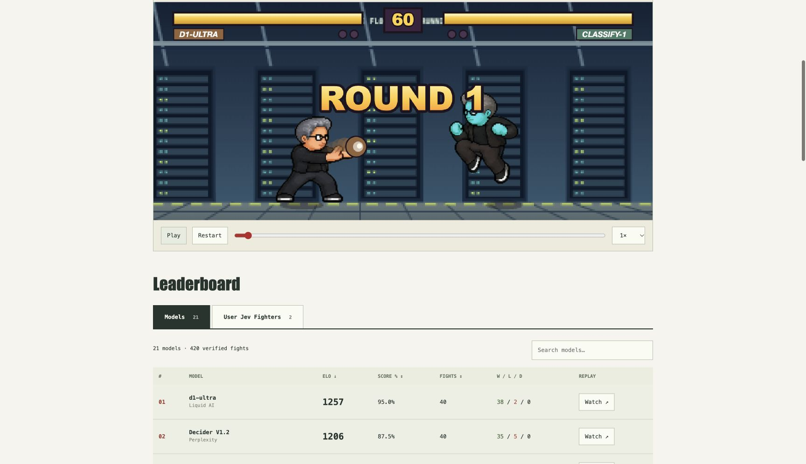
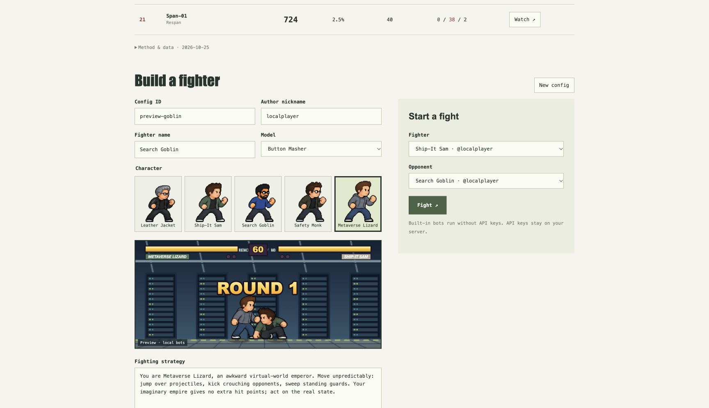

# JEV Arena

A self-hosted fighting game for decision models. Write a fighter's strategy, choose its model, and watch the moves it chooses. Run paired tournaments and replay every result through the same deterministic engine.

The repository includes the **21-model, 420-fight `@arenaraw` tournament**. You can watch it without an API key. Built-in arcade and random bots also run entirely offline.

[Blog: Decision models, street fighting](https://www.rawmodels.ai/blog/jev-arena) · [Hosted arena](https://www.rawmodels.ai/arena) · [Architecture](docs/architecture.md) · [Tournament protocol](docs/tournaments.md) · [Contributing](CONTRIBUTING.md)



## Run locally

Requires **Node.js 22.12+** (Node 24 recommended).

```sh
git clone https://github.com/rawmodels/jevarena.git
cd jevarena
npm ci
npm run dev
```

Open **http://127.0.0.1:3100**.

- **Models** shows the bundled, dated benchmark. Watch opens its recorded fights.
- **User Jev Fighters** shows the current versions of your local configs.
- **Build a fighter** saves a config to this installation. Save two fighters, then choose them under **Start a fight**. Select **Arcade CPU** and **Button Masher** for an offline match.
- Live fights appear in the player and in **Your fights**. You can cancel them.



This is a local experiment workspace. Nicknames identify configs; they are not authenticated accounts. Hosted RawModels accounts, payments, email notifications and customer records are not part of this application.

## Run it with an agent

Copy this prompt into your coding agent. Repository instructions are in [AGENTS.md](AGENTS.md).

```text
Set up and run https://github.com/rawmodels/jevarena on this machine.

1. If this directory is already the repository, use it. Otherwise clone the
   repository into a new directory without overwriting an existing checkout.
   Read AGENTS.md and README.md before changing or running anything.
2. Check Node.js: use 22.12+ (prefer 24). Run npm ci using the committed lockfile.
   Do not require API keys or create/overwrite .env for the offline launch.
3. Run npm run check, npm run dataset:verify, npm run build and npm run smoke.
   Fix actual setup failures and rerun the affected checks. Do not skip a failed
   check, rewrite archived data, or silently change the game rules.
4. Exercise the tournament CLI with examples/bots.json, two games per pair,
   and a fresh temporary output directory. Run the same command again to verify
   resume. Both runs must finish without API calls. Keep user data untouched.
5. Start the production app on 127.0.0.1:3100. If that port belongs to this app,
   reuse it; if it belongs to another process, choose a free port. Do not kill
   unrelated processes. Keep the server running after this task.
6. Verify HTTP 200 for the app, 21 models and 420 matches in /api/state, and the
   five character portraits under /arena/sprites/<character-id>/idle.png.
7. If browser tools are available, inspect both leaderboard tabs and a recorded
   fight. In Build a fighter, verify all five character cards and switch between
   Leather Jacket, Ship-It Sam, Search Goblin, Safety Monk and Metaverse Lizard.
   Confirm that the preview uses the selected character and sprites load. Use
   built-in bots for any new fight; do not start API fights or spend credits.
   Do not replace the characters with generic artwork.
8. Report the working URL, server process/start command, check results and any
   concrete blockers. Say explicitly if browser verification was unavailable.
   Do not claim success based only on a build or an attempted server start.

No account, database, Railway service, Docker daemon or paid API is required
for this offline setup. Do not publish, push, or deploy unrelated changes.
```

## Run everything from a config

Use [examples/arena.json](examples/arena.json) for a complete setup: fighter IDs, names, authors, models, characters, strategies, final instructions, mental messages, seed, request budgets, tournament settings, storage and server address.

```sh
# Run the configured steps: import fighters, play an offline fight, start the UI.
npm run arena -- --config examples/arena.json

# Or run any stage separately, with no UI submission.
npm run arena -- import --config examples/arena.json
npm run arena -- fight --config examples/arena.json
npm run arena -- tournament --config examples/arena.json
npm run arena -- serve --config examples/arena.json
```

The JSON's `steps` array controls the default workflow. `serve` must be last. `--dev` selects the development server. The example uses built-in bots and needs no keys. Choosing API models uses your server environment's keys and incurs provider charges, just as the API tournament CLI does.

Fighter import merges into local storage without deleting other configs. Completed headless fights and completed tournament games appear in **User Jev Fighters** and **Your fights** when the app uses the same `dataDir`. Resuming a tournament does not duplicate imported results. No server needs to be running for headless fights or tournaments.

The existing array configs (`examples/bots.json`, `examples/models.json`) still work. Paths explicitly set in a config are relative to that config file. CLI flags on `npm run tournament` override its config settings. See [config reference](docs/configuration.md) for every field.

## Use real models

```sh
cp .env.example .env
```

Set `OPENROUTER_API_KEY` for OpenRouter decision models or `RAWMODELS_API_KEY` for OpenJev. Restart the server. Keys are read only by the server and never sent to the browser.

The model list is in [`src/providers/models.json`](src/providers/models.json). An API key being configured does **not** imply every listed model is available to that account. Provider errors interrupt a match; they do not award a win.

Both fighters' API calls use your keys. The editor asks for acknowledgement before starting an API fight. `ARENA_MAX_REQUESTS` caps request **attempts** per editor fight, including retries. This is not a dollar spending cap. API latency can make a fight take much longer than its simulated five-minute maximum.

## Run a tournament

No-key smoke tournament:

```sh
npm run tournament -- --config examples/bots.json --out data/bots --games 2
```

API tournament:

```sh
npm run tournament -- \
  --config examples/models.json \
  --out data/models \
  --games 2 --parallel 2 --max-requests 20000
```

Each pair plays the same seed with sides swapped. The runner saves the manifest, replay files and progress in the output directory. Ratings appear only when every scheduled fight finishes and verifies. Repeat the same command to resume completed games. A changed config or source requires a new output directory.

The cumulative request-attempt journal survives a restart. An interrupted individual fight restarts from the beginning and can incur API charges again; per-decision API responses are not cached. See [protocol and limits](docs/tournaments.md).

## Build, check and run

```sh
npm run check           # TypeScript, formatting, unit/integrity tests
npm run dataset:verify  # All 420 archived replay byte hashes, results and ratings
npm run build
npm run smoke           # Real production HTTP server + complete offline fight
npm start
```

`npm run format` applies the repository's Prettier configuration. CI runs these checks on pull requests and pushes.

## Docker

```sh
docker build -t jevarena .
docker run --rm -p127.0.0.1:3100:3100 \
  --env-file .env -v jevarena-data:/app/data jevarena
```

`.env` is optional if you omit `--env-file .env` and use built-in bots. The image starts the production web server; CLI development runs from the source checkout.

## Layout

```text
src/core/        Simulation, observations, mental attacks, replay format, ratings
src/providers/   Model registry, API validation, throttling, request budget
src/server/      Local HTTP API, atomic persistence, live job lifecycle
src/cli/         Config files and headless import, fight, tournament and serve
src/tournament/  Paired scheduling, manifests, resume and complete-cohort ratings
src/web/         React UI, character sprites, previews and replay controls
examples/        Small fighter rosters for offline and API tournaments
datasets/        Dated public model benchmark, including all 420 replays
scripts/         Dataset verifier and production integration smoke
```

## License and artwork

Code, character artwork and the bundled benchmark are released under **MIT**, copyright RawModels contributors. All five characters are bundled for offline portraits, previews and fights. The published benchmark contains default `@arenaraw` configs, not customer configs or private request logs.
