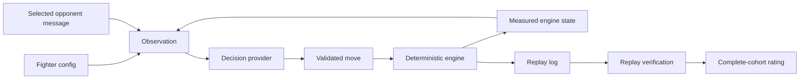

# Architecture

The physics engine is a pure TypeScript state machine. It has no network, filesystem, database or React dependency. The browser and server use the same implementation.

## One decision

1. The engine reaches a decision tick. Both fighters see the same underlying game state from their own perspective.
2. `renderState` describes measured health, distance, action phase and cooldowns.
3. `composeObservation` appends the fighter's strategy, the opponent's pending message, then its final instructions. `MentalAttacks.describe` includes availability and the fighter's prepared message.
4. Both providers answer concurrently. A response must select a legal move and supply finite probabilities for every action. Yes/no providers answer one question per action in the same request; the highest score wins.
5. A physical action goes to the engine. `mental_attack` instead delivers the prepared message to the opponent's **next** decision, once, with a three-second game-time cooldown. It does not modify measured facts, health or physics.
6. The game advances. Network latency never advances the simulated clock.

Built-in policies choose from physical actions using game state. They ignore strategy and mental-attack text; they are debugging baselines, not language models.

## Replay contract

`src/core/replay-types.ts` defines the existing wire format. Short keys are retained to replay the published data exactly:

| Field                      | Meaning                                                             |
| -------------------------- | ------------------------------------------------------------------- |
| `d`                        | Physical move indices at each decision; `-1` means no physical move |
| `actions`                  | Full action indices, including `mental_attack`                      |
| `p`                        | Probability vectors in per mille                                    |
| `ms`                       | Recorded provider latency per side                                  |
| `mentalEvents`             | Accepted mental attacks and their simulation ticks                  |
| `wins`, `rounds`, `winner` | Recorded result                                                     |
| `ticks`, `hash`            | Final simulation tick and deterministic state hash                  |

New local replays also contain immutable fighter configs and the **full observation text** from each decision. The historical dataset contains engine moves and mental events but does not contain full per-decision observations. The UI does not invent missing prompts.

`Stepper` applies the recorded moves to a fresh engine state. `verifyReplay` requires a finished game, matching final tick, hash, winner and round wins. SHA-256 checks in the dataset verifier also bind each archived replay's exact original bytes.

## Boundaries

- Provider code owns credentials, response validation, timeouts, per-model pacing and retries.
- The local server owns fighter files and at most two live jobs. Editor jobs are not resumed after a process restart; completed replays persist.
- Tournament runs are separate from editor jobs and from the bundled benchmark. The CLI does not overwrite the model leaderboard.
- Local rating identities include the entire fighter config. Editing a config cannot inherit the old config's victories. Historical opponent versions remain distinct nodes in the local rating calculation.
- Model benchmark ratings and local fighter ratings are separate pools; their numbers are not directly comparable.

The HTTP API binds to loopback by default and verifies allowed Host/Origin values before accepting paid actions. It has no authentication or public multi-user isolation. Put authentication in front of a remotely exposed installation; see [SECURITY.md](../SECURITY.md).
